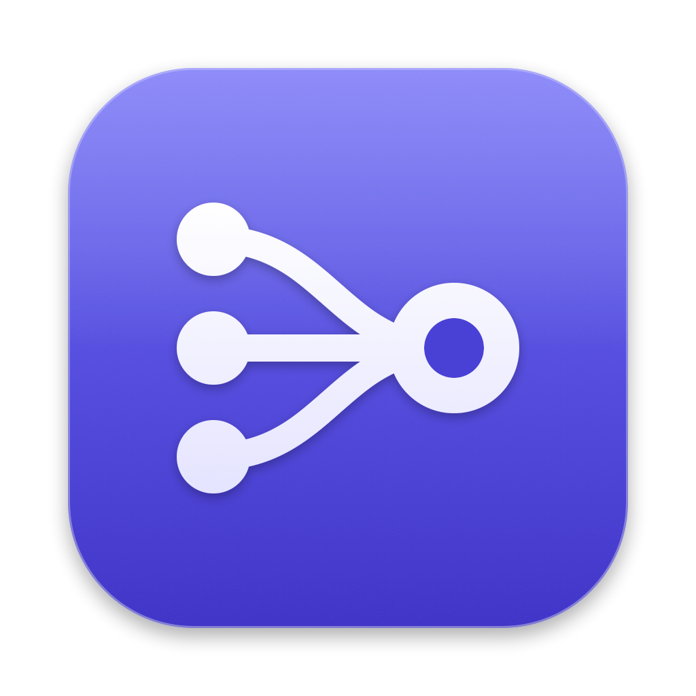
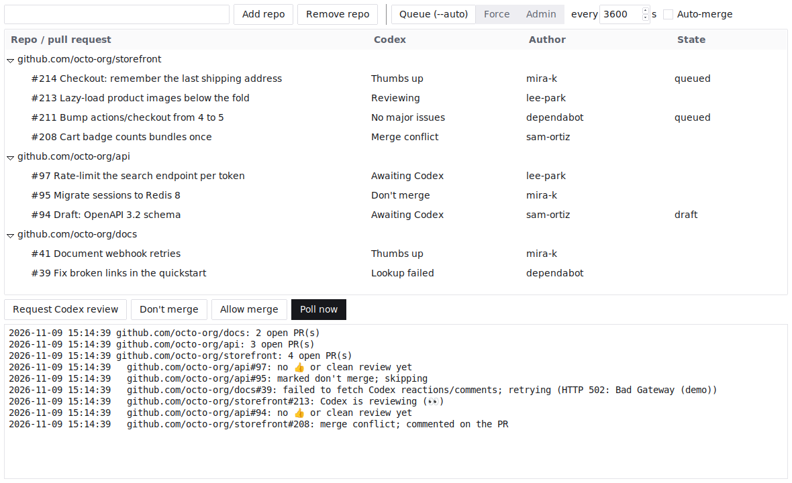

# prherd
[](https://github.com/pacnpal/prherd/actions/workflows/release.yml)

Watch GitHub repos' open PRs and squash-merge each one Codex has cleared.



Codex (`chatgpt-codex-connector`) signals "reviewed, no findings" in one of two
ways, neither of which is a review or a status check:

- a `+1` reaction on the PR body, or
- its review receipt saying **"Codex Review: Didn't find any major issues"**.
  This counts only when the receipt's `Reviewed commit:` matches the PR's
  current head, so a clean review of an older commit can't merge newer pushes.
  A free-text Codex reply containing the same words doesn't count.

Both must be newer than the PR's current commit. The commit's arrival time is
the later of its newest check suite and the PR's latest force-push, both
timestamped by GitHub (git dates can be faked). A 👍 names no commit and stays
on the PR through pushes. If neither timestamp exists, nothing merges. A check
suite added after Codex's go-ahead (say, a re-triggered workflow) also voids
it. Request a new Codex review to get a fresh one.

A PR labeled `do-not-merge` is left alone (see [Don't merge](#dont-merge)).

## Install

Every way of running prherd needs `gh` ([GitHub CLI](https://cli.github.com)) 2.48 or
newer, authenticated with merge rights on the repos.

- **Download an app** from [Releases](https://github.com/pacnpal/prherd/releases/latest):
  a `.dmg` for macOS (Apple silicon), a `.zip` for Windows (x64) or a `.tar.gz` for
  Linux (x64). Each is self-contained, so it needs no Python. The macOS app finds a `gh`
  installed with Homebrew even when opened from Finder.
- **Run from source:** Python 3 with tkinter (the python.org macOS installer includes
  it), then `./prherd.py`.

Releases are built, signed and published by GitHub Actions; see
[docs/releasing.md](docs/releasing.md).

## Usage

```bash
./prherd.py [--force|--admin] [--interval N] [--headless] [repo ...]
```

```bash
./prherd.py                                 # open the window, add repos there
./prherd.py owner/a owner/b ../checkout     # open the window with repos preloaded
./prherd.py --headless --admin owner/a      # no window; log to stdout
```

A `repo` is `owner/repo` or a local checkout directory (GitHub Enterprise hosts
work too).

### Window

**Toolbar**

- **Search**: lists only the PRs whose number, title, branch or author has every word you type. ⌘K (Ctrl+K on
  Windows and Linux) puts the cursor there, and Escape clears it.
- **Queue / Force / Admin**: the merge mode (see Behavior). While it's Admin, a banner under the toolbar says that
  merges bypass branch protection.
- **Every N s**: the polling interval.
- **Auto-merge**: switch it off to watch without merging. Conflict comments are still posted. While it's off, a
  banner says so and has a **Resume merging** button.
- **Poll now**: poll immediately. Its label counts down to the next poll.

**Sidebar** (drag its edge to resize it)

- **Views**, each with its count: All open, Ready to merge (Thumbs up or No major issues), Codex reviewing, Needs
  attention (Merge conflict or Lookup failed), Awaiting Codex, and Don't merge. Click one to list only those PRs.
- **Repositories**: each watched repo with its number of open PRs. Its dot is green when nothing is wrong, red when
  one of its PRs needs attention, orange when its last poll failed, and grey until its first poll. Click a repo to
  list only its PRs, and again to list them all.
- **+**: opens a field. Type `owner/repo` or a path and press Enter. You can monitor any number of repos at once.
- **Right-click a repo** (here or in the list): Open in browser, Copy link, Refresh (without merging), and Remove repo.
- At the bottom: the account `gh` is signed in as, and the button that opens [Settings](#settings).

**Pull requests**

The list groups each repo's open PRs under it. A newly added repo is shown right away. Merging starts on the next poll.
Over it, the heading names the view and has a count for Ready, Reviewing, Attention, and Merged today (the merges
prherd has seen since midnight). A narrow window leaves some of the counts out.

- **Pull request**: its number, title and branch. The icon beside it is Codex's verdict.
- **Codex**: Thumbs up (a 👍 reaction), No major issues (a clean review comment), Reviewing (Codex reacted 👀), Merge
  conflict, Don't merge, Awaiting Codex (no verdict yet), or Lookup failed. Merge conflict and Lookup failed rows are tinted.
- **Author**, and **State**: Open, Draft, or Queued if auto-merge is on.
- **Head**: the start of the commit the PR is at. **Age**: how long since the PR last changed. A narrow window
  leaves out Head, then Age.
- **Right-click a PR** (or Control-click on macOS): Open in browser, Copy link, Merge now, Don't merge, Allow merge, Update branch, and Request Codex review. These act on every selected PR. Double-click a PR to open it in the browser.
- **Select two or more PRs** and a bar over the heading offers Request Codex review, Don't merge, Allow merge, Update
  branch, and Merge now for all of them.
- **Select one PR** and a panel about it opens on the right (see below).

**Detail panel**

Shown while exactly one PR is selected. Drag its edge to resize it, and close it with its ×, which clears the
selection. From the top:

- The PR's repo, number, title, and its branch and base. The arrow button opens it on GitHub.
- A status card: what prherd will do with the PR, and why.
- **Merge readiness**: Codex's go-ahead on the current head, conflicts with the base, the `do-not-merge` label,
  draft or ready, and whether auto-merge is queued.
- **Timeline**: when this head was pushed, when Codex started reviewing it and cleared it, and when auto-merge was
  queued. Today's times are times of day. Older ones say how long ago. A held or conflicting PR has no times, because
  prherd doesn't look them up.
- **Merge now**, **Request review**, **Don't merge** or **Allow merge**, **Update branch**, and **Copy link**, for
  that PR. Merge now is off for a PR showing Don't merge or Merge conflict.

The list makes room for the panel by leaving out columns: after Head and Age it drops Author, State, then Codex,
whose verdict is still the icon on each row. A window too narrow to keep the Pull request column beside the panel
goes without it. The panel's width is saved with the window's other settings.

**Request Codex review** posts an `@codex review` comment on each selected PR. **Don't merge** and **Allow merge**
add or remove the `do-not-merge` label on each selected PR (see [Don't merge](#dont-merge)).

**Merge now** asks first, then squash-merges the selected PRs without waiting for
Codex, even with Auto-merge off. It asks with a sheet over the window that lists:

- each PR it will merge, with the commit it merges at. The merge is limited to that
  commit, so GitHub refuses it if someone has pushed since.
- each selected PR it skips, with why: those showing Don't merge or Merge conflict.
- how the mode treats branch protection. It uses `--admin` only when the window's
  mode is Admin. Otherwise it behaves like Force, so branch protection still applies.

A merge can't be undone, so **Cancel** is the default. Return and Escape cancel.
To merge, click the Merge button, or Tab to it and press Return or Space.

**Update branch** merges the base branch into the PR. That's a new commit, so
Codex's go-ahead no longer counts until it reviews again.

**Activity**

The log, newest line first. Each line has its time and what kind it is: merge, codex (a go-ahead), conflict, review,
error, poll, or info. Click **Activity** to collapse or expand it. Its header shows Live, or Watching while Auto-merge
is off, and how long until the next poll.

**Notifications**

prherd posts a notification when a PR merges, when one starts conflicting, when its verdict lookup fails twice in
a row, and when Codex clears one. Each can be switched off in [Settings](#settings). Nothing is posted for what was
already so at launch, or for a repo just added.

**Menu bar** (macOS)

An item in the menu bar shows how many PRs are ready to merge and how many need attention. Its menu repeats those
counts and the merges today, and has Poll now, Auto-merge, Open prherd, Settings, and Quit. Choosing a count opens
the window on that view. Turn it off with **Show in menu bar** in Settings. Closing the window still quits prherd.

The window follows the system's light or dark appearance, and switches within a poll interval when the
system does. To pin it, choose Light or Dark in [Settings](#settings) (in the settings file below, that's
`"appearance"` set to `"light"` or `"dark"`; `"system"` is the default).

The window saves its repo list, merge mode, interval, Auto-merge setting,
appearance, size, chosen view, sidebar and detail panel widths, whether the activity log is
collapsed, the notification switches, and whether to show the menu bar item to `$XDG_CONFIG_HOME/prherd.json`
(default `~/.config/prherd.json`) whenever one changes and when you close it,
and restores them at the next launch. `repo` arguments are added to the saved
list. `--force`, `--admin`, and `--interval` apply to that run only: the saved mode and interval stay as they
were unless you change them in the window. A value in the file that isn't valid falls back to its default. If the
file can't be parsed, the tool exits instead of overwriting it. If only the old
`codex-automerge.json` exists there, it's renamed to `prherd.json`. `--headless` neither reads nor writes these files.

### Settings

The button at the foot of the sidebar opens Settings. So does ⌘, (Ctrl+, on Windows and Linux). Each change
applies and is saved as you make it, so there's no OK button. The merge mode, interval and Auto-merge here are
the toolbar's own controls: change either and the other follows.

- **General**: Light, Dark or Match system. The polling interval. **Open at login**, which only changes the next
  login (a LaunchAgent on macOS, an autostart entry on Linux, a Run key on Windows). **Show in menu bar** (macOS).
  And where the settings file
  is, with a button that shows it in Finder (in Explorer on Windows; on Linux it opens the folder).
- **Repositories**: the watched repos, with add and remove. Each has a badge for whether the account `gh` is
  signed in as can merge there (admin, maintain or write permission): Can merge, Can't merge, or Unknown if `gh`
  couldn't say.
- **Merging**: the Auto-merge switch, the three merge modes with what each does, and the rules that aren't
  settings: squash pinned to the head commit, the `do-not-merge` label, one conflict comment per head commit.
- **Codex**: the account that counts as Codex, what counts as a go-ahead, and the `@codex review` comment that
  Request Codex review posts. Nothing here can be changed.
- **Notifications**: a switch for each thing to be notified of: a PR merges, a PR starts conflicting, a verdict
  lookup fails twice in a row, Codex clears a PR. The pane says so if this computer has nothing to show
  notifications with (macOS uses `osascript`, Linux `notify-send`).

### First run

With no repos to watch, the window is the toolbar over a first-run screen. The sidebar, the list and the log
come back as soon as a repo is added, and removing the last repo brings the screen back.

- **Repository**: type `owner/repo` or a path and press Return. If it can't be added, the reason is shown under
  the field.
- **Setup**: whether `gh` is installed and new enough, and whether it's signed in, with what to do if not.
  **Re-check** asks again.
- **What counts as a go-ahead**, in three points.

While it's up, the window can't be made too short to show all of it.

## Options

| Option | Description |
| --- | --- |
| `repo ...` | Repos to monitor at startup. More can be added in the window. |
| `--force` | Merge without requesting auto-merge. This does not bypass branch protection. |
| `--admin` | Merge with administrator privileges and bypass branch protection. |
| `--interval N` | Positive polling interval in seconds. Defaults to `60`, or to the saved interval in the window. |
| `--headless` | Run without a window, logging to stdout. With no `repo`, uses `REPO` or the current directory's repository. |
| `--version` | Print the version. A source checkout says `0.0.0-dev`. |
| `-h`, `--help` | Print command usage. |

### Environment variables

| Variable | Default | Description |
| --- | --- | --- |
| `REPO` | Current directory's repository | Repo for `--headless` when no `repo` is given. |
| `XDG_CONFIG_HOME` | `~/.config` | Directory holding the window's saved settings. |
| `BOT_ID` | `199175422` | GitHub user id whose 👍 or clean comment authorizes a merge. |

`199175422` is `chatgpt-codex-connector[bot]`. The tool matches the numeric id,
not the login, so no other account can pass as Codex.

## Hivemind

The included `Procfile` is for [Hivemind](https://github.com/darthsim/hivemind), a process manager for Procfile-based applications. Replace `owner/repo` with the repositories to monitor (space-separated), then run:

```sh
hivemind
```

## Behavior

Every interval it lists each repo's open PRs, checks each one for Codex's
go-ahead, and runs `gh pr merge --squash --auto --match-head-commit <head>`,
which queues the merge behind the repo's required checks. `--match-head-commit`
makes GitHub refuse the merge if someone pushed after the poll.

A PR GitHub reports as conflicting with its base isn't checked or merged.
Instead the tool comments on it once per head commit, even with merging off, saying it has merge
conflicts with the base branch. A hidden marker in that comment keeps it from
commenting again, including after a restart. Only the marker in a comment
from the account `gh` is logged in as counts. GitHub works out whether a PR
conflicts in the background, so a fresh push can take one more poll to be
flagged.

Where auto-merge isn't allowed on the repo, `gh` rejects that, and it
retries the merge without `--auto`. The fallback is gated on that specific
error, so a conflict or a failing required check still logs `MERGE FAILED`
rather than merging.

`--force` skips `--auto` and merges immediately. It does **not** bypass branch
protection: on a repo with required checks, GitHub rejects the merge until they
are green, so a 👍'd PR logs `MERGE FAILED` each poll and merges once it is
mergeable.

On a branch with a **merge queue**, `--force` cannot merge now at all: with
required checks pending, `gh pr merge` enables auto-merge even without `--auto`.
The tool does not claim otherwise — it only logs `merged now` when `gh` says
`Merged pull request`, and logs `not merged` plus `gh`'s own message otherwise.
Only `--admin` bypasses a merge queue.

`--admin` is `--force` plus `gh pr merge --admin`, which bypasses branch
protection outright — required checks, required reviews, merge queue, and all.
It needs admin rights on the repo.

The two are mutually exclusive; the last one wins (`--admin --force` runs as
`--force`). Any other flag, a non-numeric interval, or `0` exits with usage.

> [!NOTE]
> On the fallback, `--force`, and `--admin` paths the merge happens
> **immediately**, not after CI. With `--admin` Codex's go-ahead is the *only*
> gate, apart from the `do-not-merge` label: PRs merge with CI red, CI still
> running, or other reviews outstanding.

Runs until you stop it. Everything is logged with timestamps.
If listing PRs or reading Codex's reactions or comments fails, it logs the failure and retries on
the next interval.

### Don't merge

A PR with the `do-not-merge` label (any case) is never merged, in any mode, even
with Codex's go-ahead. Because the mark is a label on GitHub, it applies to
`--headless` runs and survives restarts. Set it from the window's right-click
menu or **Don't merge** button, which create the label if the repo doesn't have
it, or from GitHub's web UI. Removing the label makes the PR eligible again on the next poll.

- Marking a PR that's already queued with `--auto` also cancels the queued
  auto-merge, which GitHub would otherwise finish on its own. The window does
  this right away. A label set anywhere else takes effect on the next poll, so a
  queued PR whose checks pass before then can still merge.
- Labels are re-read right before each merge. If that lookup fails, the PR isn't
  merged and the next poll retries.
- A marked PR is otherwise left alone: its Codex verdict isn't looked up, and
  it gets no merge conflict comment.
- A PR that has already entered a merge queue stays there. Remove it on GitHub.

## Check

```sh
python3 -m unittest test_prherd
```

The screenshot above is taken by the Screenshots workflow, which runs the real window
on a virtual display against demo data (`scripts/screenshots.sh`). It's refreshed on
every push to `main` that touches the app.

## Caveat

A 👍 or clean comment from Codex means Codex found nothing — it says nothing about other
reviewers or human approval. Point this at repos where that is the bar you want.
